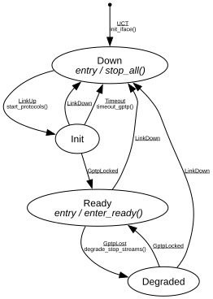

# Device Supervisor

**Implements:** (no standard — application-level orchestrator over the protocol SMs below)

| State | Entry | Exit |
|-------|-------|------|
| Down | stop_all() | - |
| Ready | enter_ready() | - |

| Event | Start | Down | Init | Ready | Degraded |
|-------|--------|--------|--------|--------|--------|
| UCT | init_iface() -> Down | -x- | -x- | -x- | -x- |
| LinkUp | -x- | start_protocols() -> Init | -x- | -x- | -x- |
| LinkDown | -x- | -x- | -> Down | -> Down | -> Down |
| GptpLocked | -x- | -x- | -> Ready | -x- | -> Ready |
| GptpLost | -x- | -x- | -x- | degrade_stop_streams() -> Degraded | -x- |
| Timeout | -x- | -x- | timeout_gptp() -> Down | -x- | -x- |
