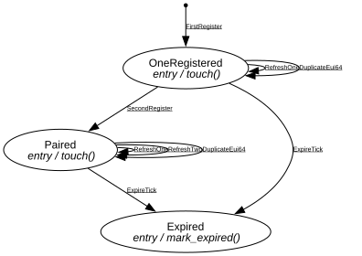

# STUN Server Session

**Implements:** RFC 8489 (STUN) + private REGISTER extension for rendezvous

| State | Entry | Exit |
|-------|-------|------|
| OneRegistered | touch() | - |
| Paired | touch() | - |
| Expired | mark_expired() | - |

| Event | Empty | OneRegistered | Paired | Expired |
|-------|--------|--------|--------|--------|
| FirstRegister | -> OneRegistered | -x- | -x- | -x- |
| SecondRegister | -x- | -> Paired | -x- | -x- |
| RefreshOne | -x- | -> OneRegistered | -> Paired | -x- |
| RefreshTwo | -x- | -x- | -> Paired | -x- |
| DuplicateEui64 | -x- | -> OneRegistered | -> Paired | -x- |
| ExpireTick | -x- | -> Expired | -> Expired | -x- |
